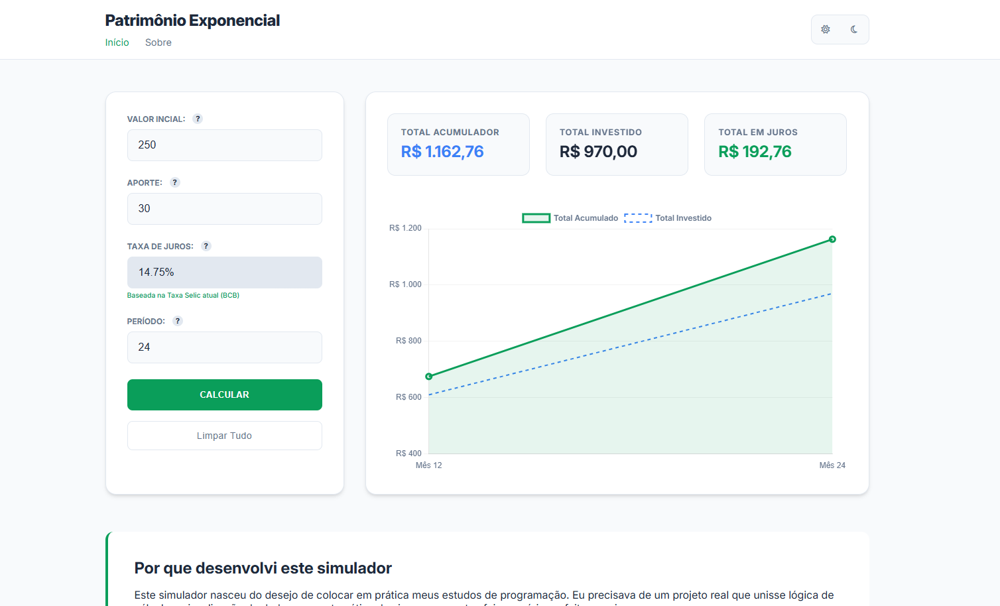
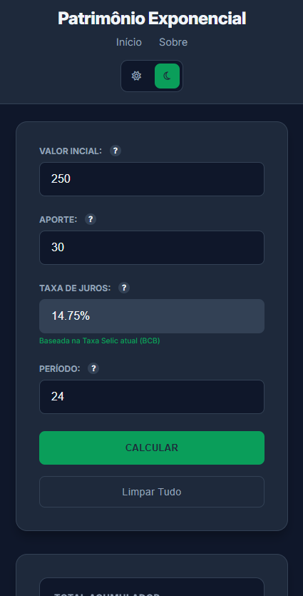

# Patrimônio Exponencial

> Simulador financeiro com integração à API do Banco Central para consulta da taxa Selic, cálculo de juros compostos e visualização dos resultados.

<div align="center">
  
  
</div>

## Sobre o projeto

Esse simulador foi um projeto que decidi desenvolver para colocar em prática o que estou estudando de programação. Eu queria criar uma aplicação que unisse lógica de cálculo e visualização de dados, utilizando a matemática dos juros compostos como cenário.

O objetivo foi criar uma experiência visual clara para apresentar os resultados de uma simulação financeira.

## Tecnologias utilizadas

- **JavaScript (Vanilla JS e ES6):** lógica de cálculo, manipulação do DOM e comportamento da aplicação.
- **API do Banco Central:** utilização da Fetch API para consultar a taxa Selic.
- **Chart.js:** criação do gráfico para visualização dos resultados.
- **HTML e CSS:** estrutura da página e estilização da interface.
- **CSS Grid e Flexbox:** organização do layout responsivo.
- **Git e GitHub:** versionamento e armazenamento do código.

## Funcionalidades

- Simulação de investimentos com valor inicial, aporte mensal e período.
- Consulta da taxa Selic por meio da API do Banco Central.
- Cálculo do total acumulado, total investido e total em juros.
- Gráfico com a evolução do total acumulado e do total investido.
- Validação dos campos de entrada.
- Tratamento de falhas na consulta da API, com utilização de uma taxa de fallback.
- Alternância entre os temas Light e Dark.
- Funcionalidade para limpar os dados da simulação.

## Identidade visual e UI/UX

Desenvolvi o layout com foco em um dashboard financeiro, utilizando variáveis CSS para manter a consistência visual entre os modos claro e escuro.

| Elemento | Light Mode | Dark Mode |
| :--- | :--- | :--- |
| Destaque (ação) | `#0A9E5A` | `#087F49` (hover) |
| Superfície (cards) | `#FFFFFF` | `#1E293B` |
| Texto principal | `#1E293B` | `#F1F5F9` |
| Texto secundário | `#64748B` | `#94A3B8` |
| Bordas e linhas | `#E2E8F0` | `#334155` |

### Diferenciais da interface

- **Tipografia Inter:** utilizada para favorecer a legibilidade.
- **Mensagens de validação:** orientações apresentadas ao usuário quando determinadas entradas são inválidas.
- **Preservação da taxa Selic ao limpar o formulário:** o campo da taxa não é apagado junto com os dados da simulação.

## Desafios técnicos

### Integração do Chart.js

Como não utilizei um compilador como o Vite, precisei trabalhar com a biblioteca por meio de uma CDN e lidar com a importação dos módulos.

### Layout responsivo

Durante o desenvolvimento, identifiquei problemas na disposição dos cards em algumas dimensões de tela e reorganizei a estrutura do layout para melhorar o comportamento responsivo.

### Tratamento de erros na API

Implementei a verificação de `response.ok` e um valor de fallback para permitir que a aplicação continue realizando a simulação quando ocorre uma falha na consulta da taxa Selic.

### Organização do código

Durante o desenvolvimento, identifiquei funções repetidas e reorganizei partes da implementação para reduzir duplicações.

## Testes de Qualidade (QA)

Além do desenvolvimento, realizei testes manuais para avaliar o comportamento da aplicação, as validações dos campos, os resultados da simulação e a integração com a API do Banco Central.

A documentação de QA está organizada em:

- [Reconhecimento do sistema](./docs/qa/01-reconhecimento-do-sistema.md)
- [Plano de testes](./docs/qa/02-plano-de-testes.md)
- [Casos de teste](./docs/qa/03-casos-de-testes.pdf)
- [Execução dos testes](./docs/qa/04-execucao-dos-testes.pdf)
- [Relatório de bugs](./docs/qa/05-relatorio-de-bugs.pdf)
- [Testes de API](./docs/qa/06-testes-de-api.md)

### Resumo da execução

Foram executados 38 casos de teste. Ao final da avaliação, 37 estavam aprovados e 1 permaneceu inconclusivo (CT-19), pois não foi confirmado se a mensagem nativa de validação do navegador correspondia ao comportamento esperado.

Não foram confirmados bugs durante essa execução.

## Como executar o projeto

1. Clone este repositório:

   ```bash
   git clone https://github.com/Felipe-C-Gonzalez/patrimonio-exponencial.git
   ```

2. Acesse a pasta do projeto:

   ```bash
   cd patrimonio-exponencial
   ```

3. Abra o arquivo `index.html` no navegador ou utilize a extensão Live Server no VS Code.

## Desenvolvido por

**Felipe C. Gonzalez**

- [LinkedIn](https://linkedin.com/in/felipecgonzalez)
- [GitHub](https://github.com/Felipe-C-Gonzalez)

---

Projeto desenvolvido para fins de estudo e prática de desenvolvimento Frontend e Quality Assurance (QA).
